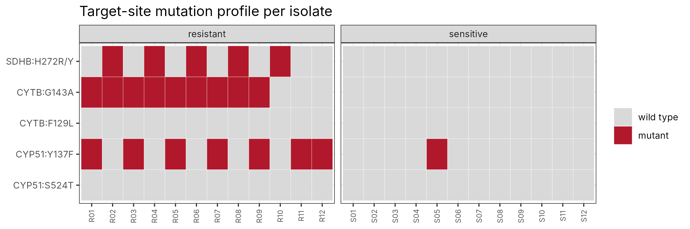
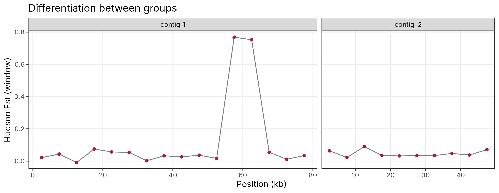

# fungal-comparative-genomics

`cgpipe` is a Python and R toolkit for comparative genomics across fungal or microbial isolates: VCF filtering with an audit trail, population differentiation and diversity, a SNP–phenotype association scan, coding-consequence annotation, screening against a panel of known target-site mutations (for example fungicide resistance alleles), and structural-variant summaries including promoter overlaps.

It was written for the kind of question that comes up in resistance monitoring: given whole-genome data from sensitive and resistant isolates, which known mutations are present in which isolates, where do the two groups differ genomically, and are there structural changes (promoter insertions, gene duplications) near target or transporter genes?



## Features

| Module | What it does |
|---|---|
| `io.py` | Dependency-free readers for FASTA, GFF3 (gene → mRNA → CDS, multi-exon) and VCF/VCF.gz. Genotypes become alt-allele dosages, so haploid and diploid samples are handled the same way. |
| `filters.py` | QUAL, FILTER, per-genotype depth masking, site missingness, MAF, biallelic and monomorphic filters. Every removed site is counted by reason in `filter_audit.tsv`. |
| `popgen.py` | Per-group allele frequencies, unbiased nucleotide diversity, Hudson's Fst (combined as a ratio of averages, following Bhatia et al. 2013), windowed statistics, pairwise p-distance, genotype PCA, and a per-site Fisher's exact association test with BH correction. |
| `annotate.py` | Maps SNPs onto spliced CDS on either strand, reports codon, amino-acid change and HGVS protein notation, and screens a user-supplied panel such as `CYTB G143A` or `SDHB H272R/Y`. Panel reference residues are checked against the gene model, so numbering errors fail loudly instead of silently missing a mutation. |
| `sv.py` | SV type and size classes, per-group carrier frequency, and strand-aware overlap with gene bodies and promoters. |
| `R/plot_genomics.R` | PCA, windowed Fst and diversity, association Manhattan plot, UPGMA tree, SV size distribution and an isolate-by-mutation heatmap (ggplot2). |

## Quick start

```bash
pip install -e ".[test]"                         # numpy, pandas, scipy, pyyaml
python -m cgpipe simulate -o data/example        # synthetic example dataset
python -m cgpipe run -c config/config.yaml       # full analysis (+ R figures if Rscript is available)
python -m pytest -q tests
```

Or `make all`.

## Using your own data

Point `config/config.yaml` at:

- a multi-sample VCF from GATK, bcftools or FreeBayes (SNPs and indels) and, optionally, the same or a separate VCF from an SV caller such as Delly, Manta or Sniffles that uses `SVTYPE`/`END`/`SVLEN`;
- the reference FASTA and a GFF3 annotation (needed for coding consequences and windows);
- `groups.tsv`, two columns: sample and group (for example sensitive/resistant, or region of origin);
- optionally a mutation panel (`config/known_mutations.tsv`) with columns `gene`, `mutation` and any extra metadata columns you want carried through to the output.

Codon numbering for target-site mutations is often species-specific (CYP51 is the classic case), so the panel must use the numbering of the gene model in your GFF. The pipeline raises an error when the panel's reference residue does not match.

## Outputs

```
results/example/
├── REPORT.md, summary.json
├── filter_audit.tsv                 sites removed per reason
├── snp_sites.tsv                    per-site frequencies, pi, Fst, association p-values
├── windows.tsv                      windowed SNP density, pi per group, Hudson Fst
├── distance_matrix.tsv, pca.tsv, pca_variance.tsv
├── snp_annotation.tsv               coding consequences with HGVS protein notation
├── known_mutation_hits.tsv          panel mutations found, with carrier isolates
├── isolate_resistance_profile.tsv   isolate x mutation matrix
├── sv_calls.tsv, sv_summary.tsv, sv_gene_overlap.tsv
└── figures/
```

## Validation on the example data

The simulator builds a two-contig reference with four genes (a single-exon plus-strand CYTB, a two-exon SDHB, a minus-strand CYP51 and an ABC transporter), 24 haploid isolates and a VCF that includes low-quality, multiallelic, low-depth and missing records. Known effects are planted and written to `ground_truth.tsv`.

| Planted feature | Recovered |
|---|---|
| CYTB G143A in 9 resistant isolates | 9 carriers, correct isolates |
| SDHB H272R (second exon, tests splicing) in 5 | 5 |
| CYP51 Y137F (minus strand) in 8, including one sensitive isolate | 8 |
| 150 bp insertion in the CYP51 promoter | Reported as a promoter overlap, resistant-only |
| 3 kb duplication spanning ABC1 | Reported as a whole-gene duplication |
| Differentiated block at contig_1: 55–65 kb | Windowed Fst ≈ 0.75 against a background of < 0.1 |



The 14 tests cover genotype parsing, SV coordinates, filter accounting, depth masking, Fst and pi formulas, distance with missing data, PCA, minus-strand and multi-exon coordinate mapping, missense calling on both strands, panel mismatch detection, promoter overlap and an end-to-end run against the ground truth.

## Limitations

- The association scan is a Fisher's exact test per site and ignores population structure. Treat hits as candidates and confirm them with a mixed model (GEMMA, GAPIT) or with the phenotype data directly.
- Diversity per bp assumes every site in a window is callable. With real data, supply callable-site counts from a coverage mask.
- Only SNPs are annotated for coding consequences; indel frameshift annotation is better done with SnpEff or VEP, whose output can be merged on position.

## License

MIT. All example data are synthetic; gene names are used only to make the example readable.
